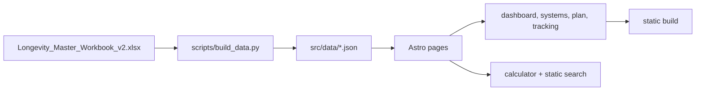

<div align="center">

# The Longevity Protocol

**An evidence-graded operating manual for one body.**

[](https://adineo-cmd.github.io/longevity-protocol/)
   

[](https://github.com/adineo-cmd/longevity-protocol/stargazers) [](https://github.com/adineo-cmd/longevity-protocol/commits)

[Live site](https://adineo-cmd.github.io/longevity-protocol/) · [Quick start](#quick-start) · [How it works](#how-it-works) · [Features](#features)

</div>

---

Built from `Longevity_Master_Workbook_v2.xlsx`: **546 graded rows across five
body systems**, a mistake sheet with verdicts, a twelve-week plan, blank tracking
logs and a profile-field catalogue. Every knowledge row carries its evidence
grade and its source.

The site adds a live calculator and static search on top of the same data.

## Features

| | Feature | What it does |
| --- | --- | --- |
| 🧬 | **Five body systems** | Each row graded by evidence strength, with the source attached. |
| ⚠️ | **Mistake sheet** | Common interventions and a verdict on each, instead of a list of tips. |
| 📅 | **Twelve-week plan** | A sequenced program with anchors and a baseline handoff. |
| 🧮 | **Live calculator** | Turns profile inputs into targets without sending data anywhere. |

## How it works

The workbook is the source; the site only reads generated JSON:

1. `data/Longevity_Master_Workbook_v2.xlsx` is the authored source.
2. `scripts/build_data.py` parses it into `src/data/*.json`.
3. The generated JSON is committed, so the site builds without Python.
4. Astro renders the dashboard, system pages, plan, tracking, profile and
   calculator from that JSON.



## Quick start

**Install and run**

```bash
npm install
npm run dev
```

**Production build**

```bash
npm run build
npm run preview
```

## Project structure

```text
data/                 source workbook
scripts/build_data.py workbook → JSON
src/data/             generated content + site metadata
src/components/       grade chip, data table, section renderer
src/pages/            dashboard, systems, mistakes, plan, tracking, profile, about
public/               static assets
```

## Deployment

Every push to `main` builds the site and deploys it to GitHub Pages
through `.github/workflows/deploy.yml`:

**https://adineo-cmd.github.io/longevity-protocol/**

The output is fully static — no server, no database, no runtime environment
variables.

## Regenerating the data

```bash
npm install
npm run data      # requires Python 3 with openpyxl
npm run dev
npm run check
npm run build
```

Educational reference only — not medical advice. The site footer carries the
full disclaimer.
